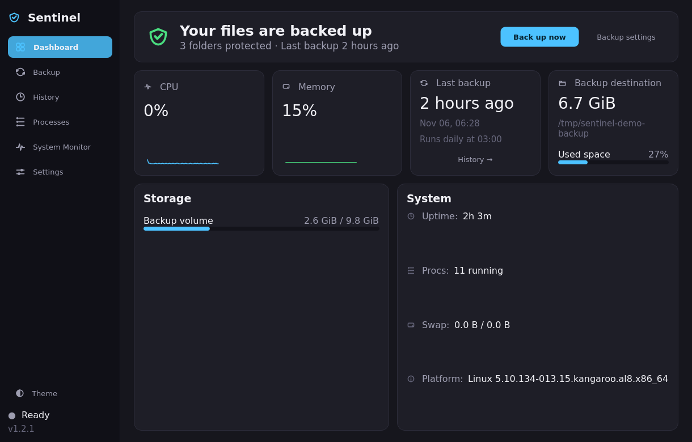
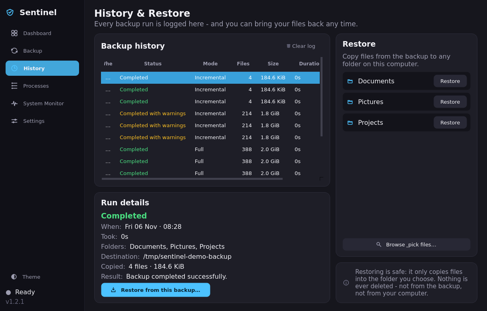

# Sentinel

**Automatic backups and a friendly system monitor for Linux.**

Sentinel quietly keeps your folders safe with [rsync](https://rsync.samba.org/)
and shows what your machine is doing — CPU, memory, network, disks and
processes — in one clean, themeable window. No terminals required.


| | |
| --- | --- |
|  |  |
| *The dashboard — backup health at a glance* | *Every run logged, files restorable in two clicks* |

## Features

- **Automatic backups** — pick folders, pick a destination, choose
  *Incremental* (fast, recommended), *Mirror* (exact copy) or *Full copy*;
  schedule hourly / daily / weekly and forget about it.
- **History & restore** — every run is logged with status, size and
  duration. Restore a whole folder in two clicks, or browse the backup as
  a file tree and tick exactly the files you want back. Restoring never
  deletes anything and defaults to a fresh `~/Sentinel restored/…` folder.
- **System monitor** — live CPU graph (total + per core), memory, swap,
  network up/down rates and disk usage.
- **Task manager** — searchable, sortable process list with *End task*.
- **8 color themes** — six dark (Midnight, Graphite, Nord, Dracula, Mocha,
  Rose Pine) and two light (Daylight, Paper), switching instantly.
- **Friendly by design** — first-run wizard, desktop notifications through
  the system tray, keyboard shortcuts (`Ctrl+1…6`, `Ctrl+,`).
- **Safe by construction** — restores and backups never delete data you
  didn't explicitly ask about; mirror mode always confirms first.

## Requirements

- Linux with a graphical session (X11 or Wayland)
- Python **3.9+**
- `rsync` (pre-installed on nearly every distribution)

## Quick start

```bash
git clone https://github.com/YOUR_USERNAME/sentinel.git
cd sentinel

python -m venv .venv && source .venv/bin/activate
pip install -r requirements.txt

python -m sentinel        # or: python run.py
```

The first run opens a short setup wizard: choose folders, a destination
(an external drive or a second disk works great) and a schedule.

### Installing it properly

```bash
pip install -e .          # adds the `sentinel` command
./install.sh              # + application-menu entry, icon, systemd timer
```

`install.sh` is user-level — no root needed. Run `./install.sh --no-timer`
to skip the scheduled-backup timer.

## Restoring your files

1. Open **History** (sidebar or `Ctrl+3`).
2. Quick way: press **Restore** next to a folder, choose where it should
   go, confirm. Done.
3. Precise way: **Browse & pick files…** — tick folders and files in the
   tree (uncheck single items inside a checked folder to leave them out),
   choose a target, **Restore**.

Backups update in place, so restoring always uses the newest saved state.
Restores only ever *add or overwrite* files in the folder you pick.

## Scheduled backups around the clock

Sentinel can run backups while it's open, but for backups that happen even
when it isn't, use the built-in systemd units:

```bash
mkdir -p ~/.config/systemd/user
cp data/systemd/sentinel-backup.{service,timer} ~/.config/systemd/user/
# point the service at your sentinel executable, then:
systemctl --user daemon-reload
systemctl --user enable --now sentinel-backup.timer
```

The timer runs `sentinel --backup-now` (no GUI) daily at 03:00 — edit the
`OnCalendar=` line to change the time, or use the follow-up in-app timer
installer. Runs made this way show up in the History screen too.

## Keyboard shortcuts

| Keys | Action |
| --- | --- |
| `Ctrl+1` … `Ctrl+6` | Dashboard / Backup / History / Processes / Monitor / Settings |
| `Ctrl+,` | Jump to Settings |

## Development

```bash
pip install -e ".[dev]"
QT_QPA_PLATFORM=offscreen pytest -q     # full suite, no display needed
python tools/screenshot.py              # refresh docs/screenshots
python tools/make_icon.py               # regenerate the app icon
```

The test suite runs the real rsync engine against temporary folders and
drives the actual UI offscreen — see `tests/` and `CONTRIBUTING.md`.

### Project structure

```
sentinel/              the Python package
    config.py          settings (~/.config/sentinel/config.json)
    history.py         backup run log (history.json)
    backup_engine.py   rsync wrapper + worker thread
    restore_engine.py  reverse rsync (bring files back)
    theme.py           design system: themes, QSS, icons, fonts
    widgets.py         reusable styled widgets
    graphs.py          scrolling graphs + sparklines
    ui/                main window + one module per screen
    main.py            entry point (GUI + --backup-now)
tests/                 pytest suite (offscreen Qt + real rsync)
tools/                 developer utilities (screenshots, icon)
data/                  .desktop file, systemd units, app icon
docs/screenshots/      the images you see above
```

## Roadmap

- [ ] Exclude patterns (skip `node_modules`, `.cache`, …) + "check first"
      dry-run preview
- [ ] Hardware panel — CPU temperatures, fan speeds, uptime details
- [ ] Smart alerts — notify on sustained high CPU/RAM or a nearly-full disk
- [ ] One-click systemd timer install from Settings
- [ ] Export a system report as HTML

## Troubleshooting

**"Failed to register with host portal … App info not found"** on startup —
harmless: Qt tries to register with xdg-desktop-portal before a `.desktop`
file exists. `./install.sh` (or the manual steps above) makes it disappear.

**Backups do nothing / finish instantly** — incremental mode only copies
what changed since last time; that's the point. Switch to *Full copy* once
to see everything transfer.

**Where is my data?** Settings and history live in
`~/.config/sentinel/`; backups go exactly where you told them to.

## License

[MIT](LICENSE) — free to use, study, modify and share.
